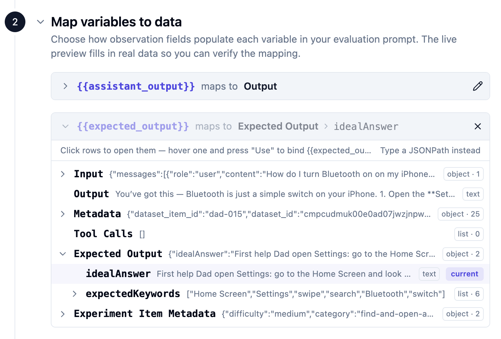

# 06 Experiments

## Starting point

```bash
git checkout checkpoint/06-experiments
```

Your dataset is seeded in Langfuse. `scripts/run-dataset.ts` is already in the repo.

## Why experiments

A trace tells you about *one* turn. An experiment tells you about behavior *across the dataset*. Every experiment run does the same three things:

1. **Pulls each item from the dataset.**
2. **Runs the item's input through the agent** — same `runSupportConversation(...)` the web app uses, so the trace shape is the same as production.
3. **Scores the actual output against the expected output** with one or more evaluators.

Different evaluators answer different questions. For a broader tour of evaluator types and when to pick which, see the [Langfuse Academy lesson on evaluate](https://langfuse.com/academy/evaluate). For this workshop we use two that give a quick first read on answer quality:

- **`keyword_overlap`** (deterministic) — *did the answer cover the steps we expected?* Fast, cheap, and computed directly in the experiment script.
- **`correctness`** (LLM-as-a-judge) — *is the answer actually correct?* More expressive, especially when the wording can vary but the underlying answer has to match the ideal. In this workshop, the script calls the judge model directly and sends the score to Langfuse.

This chapter keeps both evaluators in code on purpose. The deterministic check shows the cheapest possible scoring pattern, and the LLM-as-a-judge check shows the full programmatic path: prompt the judge, parse its response, and return a Langfuse score from the experiment runner.

## Goal

By the end of this chapter:

1. You can run the full dataset against the agent on demand.
2. Every item gets a **`keyword_overlap`** score (deterministic) and a **`correctness`** score (LLM-as-a-judge).
3. The two scores plus the per-item traces are visible in Langfuse and ready to compare against future runs.

## Step 1 — Understand the run script

Open `scripts/run-dataset.ts`. The file is annotated with numbered comments (`// --- 1. Boot the OpenTelemetry SDK ...`, `// --- 3. The deterministic evaluator ...`, etc.) so you can read it section by section. At a high level:

- Loads the hosted dataset from Langfuse by `DATASET_NAME`.
- For each item, calls the same `runSupportConversation(...)` the web app uses.
- Uses `dataset.runExperiment(...)` to roll all per-item traces into a single run row.
- Attaches a `keyword_overlap` score per item by comparing `expectedKeywords` against the agent's answer.
- Attaches a `correctness` score per item by asking a judge model to compare the actual answer and ideal answer.

Each dataset item creates a Langfuse trace. The tracing still looks like the chat traces you saw earlier:

```text
dad-it-support-chat-turn
  openai-chat-completion
  get_support_context
  search_help_library
```

The scores come from the experiment script in the main workshop path: `keyword_overlap` is computed with a simple keyword check, and `correctness` is computed by the script's LLM judge. Besides implementing this programmatically in the script, Langfuse also gives you the option to configure the LLM-as-a-judge evaluator in the UI. In that UI-managed path, your script only sends the experiment output to Langfuse, and Langfuse runs the judge asynchronously afterward.

### `dataset.runExperiment(...)` — the moving parts

The whole run is one call to `runExperiment`. The shape boils down to:

```ts
await dataset.runExperiment({
  name: "Dad IT Support Agent experiment",
  runName,           // unique label for this run; shows up in the Experiments tab
  description: "...",
  metadata: { model: env.chatModel, provider: env.openaiProvider },
  maxConcurrency: 1, // run items one at a time

  task: async (item) => {
    const response = await runSupportConversation({ /* item.input */ });
    return response.answer;
  },

  evaluators: [
    async ({ output, expectedOutput }) => ({
      name: "keyword_overlap",
      value: keywordOverlap(output as string, (expectedOutput as any).expectedKeywords),
      comment: "..."
    }),
    async ({ output, expectedOutput }) => {
      const judged = await scoreCorrectness(
        output as string,
        (expectedOutput as any).idealAnswer
      );

      return {
        name: "correctness",
        value: judged.score,
        comment: judged.reasoning
      };
    }
  ]
});
```

Three things to understand:

- **`task`** is *your application logic* — we call straight into `runSupportConversation(...)`, which means every trace this script produces looks identical to a production trace.
- **`evaluators`** is a list of callbacks. Each evaluator runs after `task` returns and attaches a score to the item trace. Here we use one deterministic evaluator and one LLM-as-a-judge evaluator.
- **`runName`** groups every per-item trace into one row in the Langfuse Experiments view. Pick a name that changes per run (we include the timestamp) so two runs don't collide.

## Step 2 — Review the deterministic `keyword_overlap` evaluator

Inside `scripts/run-dataset.ts`, the helper function looks for the dataset item's `expectedKeywords` inside the model answer and returns the fraction that matched.

Why keep it in the script?

- It is easy to read alongside the rest of the experiment code.
- It uses the same version control and review flow as the app.
- It is deterministic, so there is no reason to spend an LLM call on it.

This is also a good default pattern for teams that want experiment logic to stay in the repo.

> Alternative: this same deterministic check could also be moved into a Langfuse code evaluator if you want to manage it in the platform instead of in the script. See the [Code evaluators docs](https://langfuse.com/docs/evaluation/evaluation-methods/code-evaluators) and the [Experiments via SDK docs](https://langfuse.com/docs/evaluation/experiments/experiments-via-sdk).

## Step 3 — Review the programmatic `correctness` evaluator

Inside `scripts/run-dataset.ts`, `scoreCorrectness(...)` implements the LLM-as-a-judge path in code. It compares two things:

- the agent's actual answer from `task`
- the ideal answer from `expectedOutput.idealAnswer`

The helper uses `createOpenAIClient()`, the same Azure/OpenAI provider factory as the app. That keeps the experiment runner compatible with workshop environments that use Azure OpenAI instead of an OpenAI Platform key. The judge client is also wrapped with `observeOpenAI(...)`, so the evaluator's own model call is traced and can be inspected in Langfuse.

The judge is asked to return JSON with a boolean `score` and a short `reasoning` comment. The evaluator then maps that to a numeric Langfuse score named `correctness`:

```ts
return {
  name: "correctness",
  value: score,
  comment: reasoning
};
```

This is the key difference from the UI-managed path: here, `scripts/run-dataset.ts` owns the judge prompt, calls the judge model, parses the result, and sends the score to Langfuse.

## Step 4 — Optional alternative: configure `correctness` in Langfuse

The main workshop path above runs `correctness` from code. Langfuse can also run the same kind of LLM-as-a-judge evaluator for you from the UI. The logic moves to a different place:

```text
Script-run judge:
scripts/run-dataset.ts runs the judge model and returns the correctness score.

UI-managed judge:
scripts/run-dataset.ts sends the experiment output to Langfuse, then Langfuse runs the judge and writes the correctness score later.
```

If you want to show the UI-managed alternative, configure it like this:

1. In Langfuse, open **Evaluators → New evaluator** and pick the **Correctness** template.
2. Target the runs from this dataset:
   - Run on: **Experiments** (Default is observation, make sure to select the right 'Run on')
   - Filter where: Dataset is 'dad-it-support-workshop'
3. Map the template variables. In the UI, set the **Source** dropdown first, then add JsonPath only where needed:

   | Variable | Object Field | JsonPath |
   | --- | --- | --- |
   | `query` | **Input** | `$.messages[-1].content` |
   | `generation` | **Output** | Leave blank |
   | `ground_truth` | **Expected Output** | `$.idealAnswer` |

   A common broken setup is leaving all three variables on **Input** because that dropdown shows up first. If `generation` or `ground_truth` point to **Input**, the evaluator reads the wrong data for every run.
4. Use the default judge model you configured in session 4 or in the fresh project check above, or pick another structured-output-capable judge model, and save.
5. Enable the evaluator.

Why target **Dataset runs** here? Because for this workshop we want the score to appear on the dataset run items and in the run comparison view.

If you enable the UI-managed evaluator while the script also returns a score named `correctness`, you may see duplicate or competing correctness scores. For the main workshop path, use the script-run judge and treat this UI setup as an alternative demonstration.



## Step 5 — Run the dataset

```bash
npm run dataset:run
```

The script finishes by printing a formatted run summary in the console. Item-level traces and scores show up in Langfuse as the run executes.

The script attaches both `keyword_overlap` and `correctness` itself. If you also configured the optional UI-managed evaluator in Step 4, that platform-side score may continue filling in for a short time afterward because it runs asynchronously in Langfuse.

## What to inspect in Langfuse

- The new **Run** under your dataset → one row per item with **two** scores: `keyword_overlap` and `correctness`, plus a trace link.
- **Item-level traces** — identical shape to production traces.
- The dataset's **chart view** → per-run averages for both scores, ready for side-by-side comparison after future changes.


## How to verify you are done

- One run row appears under the dataset.
- Every item has a trace and both scores attached.
- Trace shape matches a normal production trace.

## Wrap-up

The two scoring approaches give you two angles on the same run: **keyword match** for "did we cover the right steps?" and **correctness** for "is the answer actually right?" Real evaluation programs often combine deterministic and judge-based checks like this.

In a real evaluation cycle, we would now change one part of the application, rerun the same experiment, and compare both runs. The change could affect the prompt, model, context, tools, or agent workflow. We are not completing that second iteration today, but Lesson 07 contains the full walkthrough for independent learning.

If your team prefers more evaluator logic in the Langfuse UI, the correctness judge can be managed there instead, and the deterministic check could also be migrated into a code evaluator later. The [Code evaluators docs](https://langfuse.com/docs/evaluation/evaluation-methods/code-evaluators) cover that path, and the [Experiments via SDK docs](https://langfuse.com/docs/evaluation/experiments/experiments-via-sdk) show how the code-side setup fits together.

Learn more about experiments in the [Langfuse Academy lesson](https://langfuse.com/academy/experiments).

## End state

This is the starting point for `07-evaluation`.
